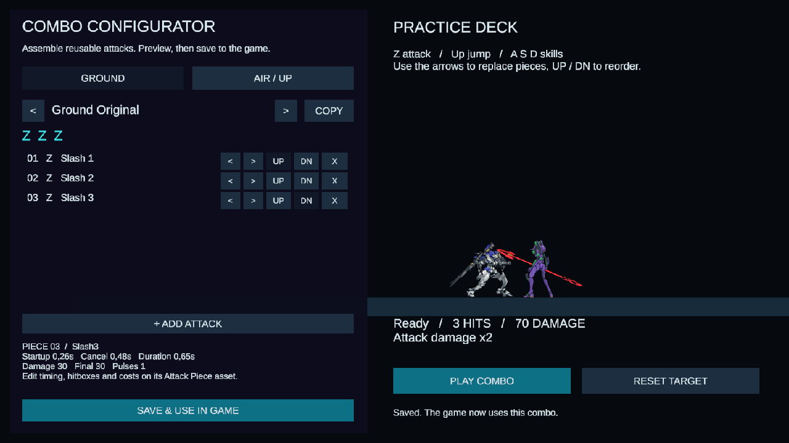

# Combat and combo configurator

Open `Assets/Scenes/ComboConfigurator.unity` and enter Play Mode.

- Choose **GROUND** or **AIR / UP**. Use the preset arrows to select a sequence.
- Each row is a reusable attack piece. `<` / `>` replaces the piece, **UP / DN** reorders it, and **X** removes it. **ADD ATTACK** appends a step, up to eight.
- **COPY** creates a separate sequence asset in the Editor.
- **PLAY COMBO** performs the selected draft against the practice target. **RESET TARGET** restores the pilot position, mana/cooldowns, and damage counter.
- **SAVE & USE IN GAME** saves the draft and selects it in the shared gameplay loadout. This is an explicit authoring operation available in the Editor. Draft editing and practice do not mutate shared gameplay assets. Unsaved drafts are discarded when switching presets or stopping Play Mode.

The initial gameplay selections preserve the existing attacks: **Ground Original** is `Z Z Z` (Slash 1, Slash 2, Slash 3); **Air Original** is `Up Z Z` (jump, Air Slash, Air Slash). Jump is the air entry, not an extra damage hit. Walking off a platform also allows the air sequence. Dash Slash, the existing ground-combo Up/Rising Slash branch, and A/S/D skills remain available.

## Authored assets

- `Assets/_Project/Settings/Attacks/` (basic pieces) and `Assets/_Project/Settings/Skills/` (active skills): nine independent pieces migrated from the previous configured attacks, including each skill. A piece contains startup/impact, duration, cancel time, pulses, hitbox, knockback, damage, mana and cooldown. Its action kind chooses the existing animation/effects style. Different pieces can reuse a style with different tuning.
- `Assets/_Project/Settings/Combos/`: reusable ordered sequences. The asset Inspector also exposes input window, looping, and ground/air context.
- `Assets/_Project/Settings/Combos/PlayerCombos.asset`: the selected ground and air sequences, dash piece and rising branch used by gameplay.
- `Assets/_Project/Settings/Attacks/PlayerCombat.asset`: the registered attack-piece catalogue and global **damage multiplier = 2**. Every player attack pulse, including final pulses and skills, uses this multiplier once on the authoritative damage path.
- `Assets/_Project/Settings/Combos/ComboConfigurator.asset`: available presets and the configurator's preview settings. To introduce a new attack asset, add it to PlayerCombat's piece catalogue; add new sequences to the configurator preset list.

Combo cursors are per-player runtime state. FishNet sends the registered piece index; the server resolves its own authored timing, costs and damage, and observers use the same piece for presentation. All peers need the matching game build/catalogue. Configuration changes are authored before a multiplayer session; live loadout distribution is not a lobby feature.

## Gameplay fixes

One-way platforms retain established support despite a small capsule/contact dip. Jumping upward still passes through; Down explicitly disables the pair for a drop. The player's separate ledge assist catches near misses within 0.28 units vertically and 0.3 horizontally, checks space, and respects Down, active drops, stun, and attack locks. Movement settings expose that tuning.

Enemy and player capsules use a native zero-friction PhysicsMaterial. This resolves enemies' floor friction cancelling their acceleration after the heavier-gravity change. Nearby melee attacks take priority over home/spacing tactics. Guards still keep their stations and hunters still pursue/intercept. Every melee strike, including an interception, now has a visible windup (currently 0.34 seconds); the former instant ambush exception is removed.

Lancers instantiate a networked projectile using the held 3D weapon model, release it from the hand, and remain empty-handed throughout cooldown. A lance returns only when the next attack windup begins. Availability remains server-owned and replicated; damage/collision remain server-owned.

## Manual validation

- Unity compilation completed without errors; Windows development builds succeeded with both scenes included. No automated tests were created or run.
- In a live host, a pilot placed 0.18 units short of Arrival Shelf was assisted onto it and remained grounded. Standing near its edge retained collision; pressing and releasing Down dropped to the floor.
- Removing actor friction during diagnosis immediately restored enemy movement. Saved assets then showed active pursuit, jumping, repeated melee damage and player revivals.
- Observed a live melee attack with 0.206 seconds of startup still remaining. Observed lances absent from the hands during cooldown and present again while the next windup was charging, with live 3D projectiles.
- Ground preview registered three hits totaling **70** (18 + 22 + 30). Air preview registered two hits totaling **40** (20 + 20).
- Replaced, added, removed and reordered draft pieces; confirmed the original asset remained unchanged until Save. Saved a reorder, then restored/saved the original initial sequence.
- A separate Windows player connected to the local editor host. It received the eight-platform room, two player states, health/revivals, projectiles and the modular Sword Fire action. No FishNet serialization/prefab errors appeared. This pass used a local connection; Relay was not re-exercised.
- One editor-control request timed out during Play Mode startup. The editor became ready and the requested host operation completed; subsequent live checks succeeded. This was a tooling timeout, not a gameplay exception.

The review client was closed. MainScene was restored, Play Mode stopped, and temporary input/background overrides were reverted. Native setup can be reapplied with **Tools > Mecha > Apply Combat and Combo Configurator**, preserving existing attack pieces and combo sequences.
