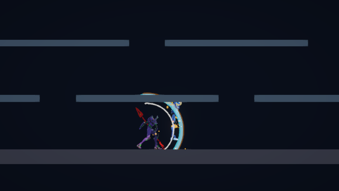

# Movement, combat and camera refinement

Research began October 13, 2026; implementation and validation continued October 14. This pass improves the existing PC-style action prototype. Game scripts, menu labels and runtime names use **Mecha** terminology; the reference game's name appears only in research documentation.

## Additional research

The official PlayPark announcement dated June 1, 2026 describes a PvP-specific hitbox overhaul. It emphasizes matching attack ranges to visible effects, changes many dash launchers into knockdowns, and introduces a room option for uninterrupted combo flow. It explicitly excludes dungeon balancing. The transferable principle here is readable spacing; this project remains a PvE prototype and does not copy those PvP-only balance changes. Basic and wave hit volumes were tightened around their effects, while deliberate launcher attacks retain their role. [Official announcement](https://gcc.playpark.com/update/060126-update-preview/).

The Knight skill reference describes Up-command combo branches that launch targets and enable follow-up attacks. It also distinguishes command attacks from the larger A/S/D specials. This supports an additional **Z → Up** branch with its own timing and no MP cost, rather than requiring every launch to consume a skill. Exact original frame data is not supplied; the prototype's 13-damage rising slash and timing are original tuning. [Knight Skill Tree](https://grandchase.fandom.com/wiki/Knight_Skill_Tree).

The community systems guide describes dash cancels, dash-jump transitions, and attacks that connect into further movement. Its job-specific descriptions demonstrate that recovery behavior differs between moves and jobs. The prototype therefore keeps explicit startup protection but makes input buffers more forgiving, allows steering during air slashes, and ends air-slash recovery on landing after the impact has happened. These changes are interpretations of fluent action chaining, not a claim that every source move behaves identically. [Damage List & Systems Guide](https://steamcommunity.com/sharedfiles/filedetails/?id=2584912679).

Historical movement material describes dash → jump → Down to make a low, fast arc, along with platform-dependent techniques. Reliable held-Down descent is a requested usability improvement: it continuously reevaluates support and recovery, allowing descent across several platforms without repeated taps. Down also keeps its airborne fast-fall behavior. This pass does not add infinite air dashes, Otto loops or frame-perfect historical exploits. [Elesis movement guide](https://www.webcheats.com.br/topic/410954-tutorial-guia-de-user-elesis/).

The introductory control guide associates Up with jumping, Down with descending and double-tap-and-hold with running. It distinguishes holding Z to charge MP from pressing Z for ordinary attacks. This prototype continues to use pressed Z for combos and direct A/S/D skills; it does not silently convert held Z into automatic attacks. [Introductory guide](https://steamcommunity.com/sharedfiles/filedetails/?id=291417716).

The Fandom full page remains blocked by robots.txt; its available indexed excerpts were used. Community movement guides are historical references, and the official 2026 announcement is explicitly scoped to PvP. Version differences and undocumented timings remain relevant limits.

## Changes

| Area | Refinement |
| --- | --- |
| Script names | `MechaGameplaySetup` and `MechaGameplayHud`; GUID-preserving Unity asset moves retain references |
| Setup menu | Tools → Mecha → Apply Mecha Gameplay |
| Camera | Dedicated `PlayerCameraFollow`; orthographic size 3.2 instead of 5.2, smooth local-owner follow, facing look-ahead and arena bounds |
| Held Down | `PlayerInputs.DownHeld` persists until release; movement reevaluates it each physics step |
| Descent during recovery | A held Down command is applied when the attack cancel window opens |
| Multiple platforms | Each newly encountered supporting platform can be dropped through while Down remains held; the floor stays solid |
| Dash input | 0.14-second buffer; a ground dash can transition to the one available air dash after jumping |
| Basic attack buffer | 0.22 seconds, allowing an early next-Z input to reach the next recovery window |
| Skill buffer | A/S/D can be queued up to 0.20 seconds before an allowed transition; MP/cooldown gates still apply |
| Up-command branch | Up during a ground combo queues a 13-damage rising slash that launches the enemy |
| Air attacks | Modest horizontal steering; post-impact landing clears the remaining air-slash recovery |
| Network recovery | 0.035-second server recovery grace accounts for the RPC tick starting after local presentation; startup remains protected |
| Hit volumes | Narrower normal and Sword Fire ranges to improve agreement with the visible arcs |

The orthographic size change makes characters approximately 62.5% larger on screen at the same viewport height. Camera Z changes alone would not increase apparent size for an orthographic camera. The camera tracks only the locally controlled player and reacquires after despawn/respawn.

## Toon Shader installation

Installed **Unity Toon Shader 0.15.1-preview** from the official repository's package subfolder through the Unity Package Manager API:

`https://github.com/Unity-Technologies/com.unity.toonshader.git?path=/com.unity.toonshader`

Unity resolved the package, its film utilities dependency, and the existing render-pipeline dependency graph. The package supports URP and declares Unity 6000.0 as its minimum. The project runs Unity 6000.3.11f1 with URP 17.3.0. This is the shader package only; its example scenes and character sample assets were not imported. [Official repository](https://github.com/Unity-Technologies/com.unity.toonshader), [package metadata](https://github.com/Unity-Technologies/com.unity.toonshader/blob/master/com.unity.toonshader/package.json), [installation instructions](https://github.com/Unity-Technologies/com.unity.toonshader/blob/master/com.unity.toonshader/Documentation~/installation.md).

Existing character materials are retained in this gameplay pass. Installing the package makes the toon shader available for a separate art-direction pass without automatically changing all materials.

## Validation

No automated tests were added or run. Validation uses source review, Unity's actual compiler, static compilation and manual Play Mode inspection. Details of the initial prototype remain in [Process and validation](ProcessAndValidation.md).

The live local host confirmed the following:

- Holding Down from the summit at x=1 traversed the stacked platform tiers. Down stayed active while falling. On release, `DownHeld=False` and normal support returned on Platform 2. The solid floor stopped descent.
- Camera size was 3.2, its follow component was attached, and its center moved with the local player. Arena limits prevented it from scrolling beyond the play space.
- The Z → Up branch selected RisingSlash on both local and server state. The target lost 22 health (9 opening damage + 13 rising damage), and its height increased.
- An immediate second Z queued Slash2 on both client and server instead of dropping the input.
- An immediate A during a normal attack queued MegaSlash on both client and server.
- An air slash started airborne, impacted, then returned to Ready on landing at y=-1.69 before its ordinary 0.19-second recovery window.
- The renamed HUD retained its actual status, skill, health and MP references.
- Gameplay and setup compiled in Unity and in separate static checks. The static checks reported only the two existing FishNet upgrade-helper deprecation warnings.

Manual inspection found and corrected two issues: SendMessages does not deliver button-release messages, so held Down/Jump now read the owner's InputAction state; and server recovery windows needed a small network-tick allowance to accept local action chains. A stale camera source-list entry was repaired by reindexing it through the AssetDatabase.

The screenshot is an actual Game View capture. Slow motion and paused-frame inspection were used for action timing; these temporary runtime states are restored before handoff. Separate internet clients, controller hardware and frame-perfect legacy exploits remain unverified.

Final inspection confirmed MainScene was saved, Edit Mode was active, pause was off, time scale was 1, and Unity reported no compilation failure. The camera follow component and renamed HUD were present. All three installed Toon shader variants reported supported, including the URP 3D-as-2D variant. The final console error check was empty. The original Cloud MCP connection was restored and the temporary local connection helper was stopped.
