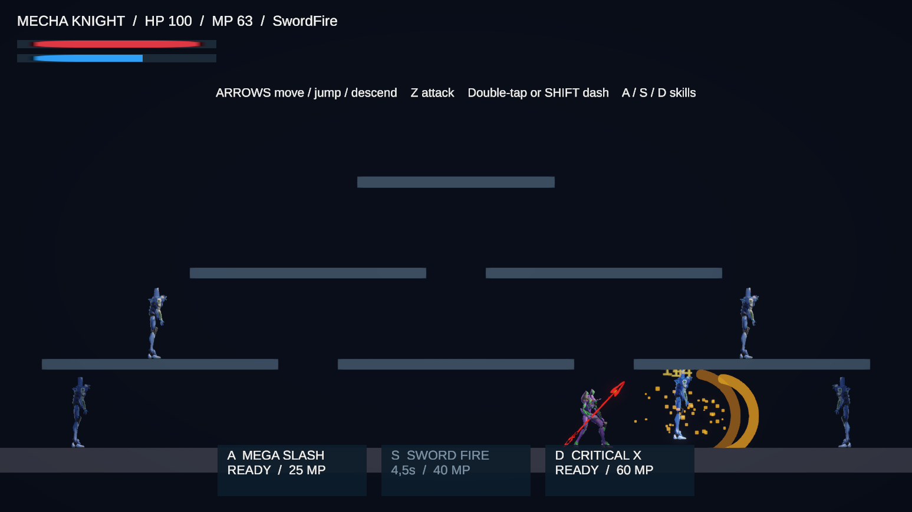
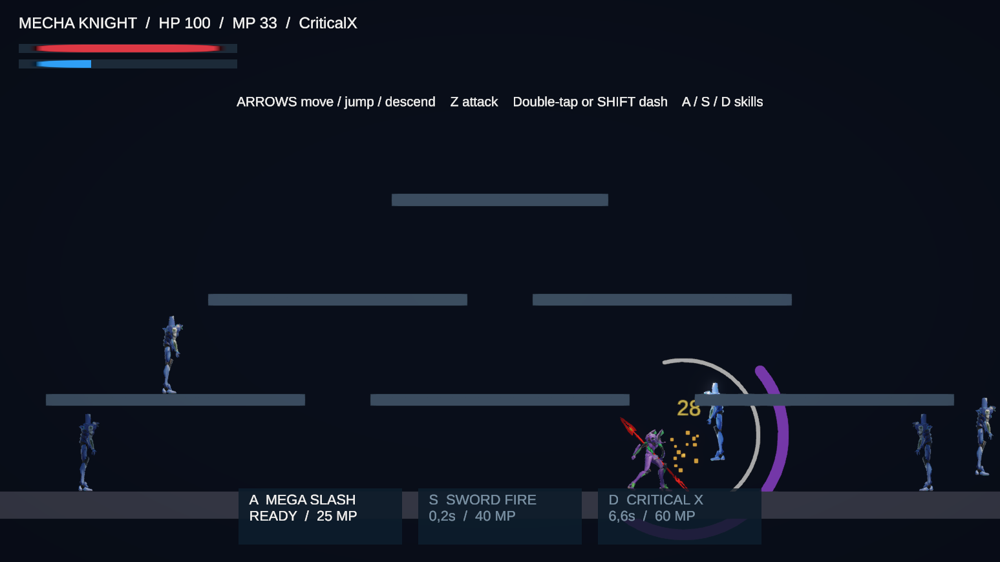

# Implementation process and runtime validation

Date: October 13, 2026. Unity project: `project-mecha`. Editor: Unity 6.3 LTS, 6000.3.11f1. The application's older Unity @-mention did not match the actual project/Editor version; implementation used the running project Editor.

## Baseline and preserved work

The working tree already had MainScene, removed SampleScene files, package/settings changes, the generated skill folder and NuGet plugin files. Those pre-existing changes were retained. No commits or branches were created.

MechaPlayer's original prefab was read on disk and then inspected live through MCP. Its separated PlayerInputs, PlayerMovement and PlayerAttack components were retained. The live scene was MainScene, with three thick platforms, a floor and boundary colliders. The player used FishNet ownership and network animation/transform components; the enemy had a simple sword-trigger despawn handler. EnemySpawner created an enemy every half-second without a population limit.

The initial recorded Editor state was **Play Mode off, pause off, MainScene active**.

## Tooling and connection recovery

1. Used the installed Unity CLI and Unity-MCP CLI for connection discovery. The official CLI found no Pipeline-equipped Editor, while Unity-MCP identified the running project.
2. The project's MCP configuration pointed at a cloud session and its local helper was stopped. Started the already-installed project helper on its configured loopback endpoint.
3. Temporarily switched the connection to the plugin's **Custom** mode for the local endpoint. An initial attempt using the name `Local` was rejected because this plugin version's enum is `Custom`/`Cloud`; corrected it and restored the original configuration structure.
4. Used the Computer Use plugin to bring Unity forward and refresh assets. This allowed script import and reloaded the MCP connection.
5. Recorded the Editor's initial state and used the installed MCP `script-execute`, `assets-refresh`, application-state, console and Game View screenshot tools for the rest of the work.

Connection repair was local to the installed Editor/project. No additional gameplay package was installed and no credentials were added to the source or documentation. The temporary connection bootstrap was removed after use.

## Implementation

- Replaced unrestricted frame-update movement with fixed-step velocity control, support checks, jump buffering, coyote time, dash/run states, one air dash and variable gravity.
- Added dash-jump momentum and Down fast-fall so a short rocket/shadow-step-style sequence can be performed with ordinary directional input.
- Added OneWayPlatform collision-pair handling, supporting jumps from below and deliberate drops. The floor remains solid. Collision pairs are cleaned up when actors or platforms are disabled.
- Replaced the attack-animation-only handler with three basic combo stages, dash/air attacks, explicit impact/recovery times and movement/skill cancel rules.
- Added A/S/D Mega Slash, Sword Fire and Critical X with costs, cooldowns, damage pulses and original procedural VFX.
- Added separate player health and presentation components. Normal hits interrupt; active skills resist interruption. Death/falling out of bounds respawns the player.
- Added enemy health, server-owned pursuit, attack warning, interruption, knockback, launching and delayed despawn. Enemy spawning is capped at six.
- Updated the Input System Player map, preserving its existing UI map. A/S/D no longer move the player; they trigger the skills.
- Updated the prefabs through Unity's PrefabUtility and the scene through live Unity APIs. No scene/prefab YAML was hand-edited.
- Retimed the existing attack animation through an Animator speed parameter, with explicit returns to locomotion on completion/cancel.
- Reworked MainScene into three reachable platform tiers plus the floor, assigned player/enemy layers and collision filtering, and added a controls/health/MP/skill HUD.
- Fixed rotated wall colliders discovered during visual inspection, improved ambient lighting and disabled the overlapping FishNet demonstration HUD in this scene. The original networking and Relay functionality remain available.
- Added a repeatable Editor setup command: **Tools → Mecha → Apply Grand Chase Gameplay**.

## Validation approach

No automated tests were created, added or run, in accordance with the standing project instructions. Validation used source review, static compilation, Unity compilation, manual Play Mode input/action inspection, targeted runtime snapshots and visual screenshots.

Temporary diagnostic payloads and compiler outputs were kept in ignored `Logs/`. They were not added as gameplay scripts or test fixtures. For precise inspection, some actions were viewed in slow motion or paused during a frame; normal speed and editor state were restored afterward. Enemies were temporarily frozen/repositioned during isolated movement and skill inspection. Those runtime-only changes were discarded when Play Mode ended.

## Observed results

| Inspection | Actual observation |
| --- | --- |
| Runtime compilation | Gameplay and Editor setup sources compiled successfully. Two existing FishNet upgrade-helper deprecation warnings appeared in static compilation. |
| Unity host | Local UnityTransport server/client connected and spawned the owned MechaPlayer. |
| Ground support | Player at `(0, -3.50, 0)` had zero velocity, `grounded=True`, support `Ground`. |
| Jump from below | Held jump moved the player from the floor through Platform 2; an ascent snapshot had position `(0, -1.59, 0)` and upward velocity `1.84`. |
| Landing | After releasing the jump, the player settled at `(0, -1.69, 0)`, zero velocity, `grounded=True`, support `Platform 2`. |
| Platform descent | Down on Platform 2 returned the player to the solid floor at `y=-3.50`. |
| Dash | A manual dash began with horizontal velocity `-11.50` and `dashing=True`. |
| Dash-jump | Captured position `(1.44, -2.61, 0)` with velocity `(11.50, 7.12, 0)` and no support, confirming simultaneous dash momentum and ascent. |
| Down after dash-jump | Same paused airborne state changed to velocity `(11.50, -6.00, 0)`, preserving horizontal momentum while cutting the arc. |
| Startup commitment | Slash1 reported `cancelAllowed=False` immediately after starting. |
| Recovery cancellation | On a captured recovery frame, action was still `Slash1`; movement cancel returned `True`, action became `Ready`, and a subsequent dash started at `-11.50`. |
| Mega Slash | Target health changed `90 → 48`, matching four pulses totaling 42. HUD showed the 25 MP expenditure and cooldown. |
| Sword Fire | Target health changed `48 → 6`, matching three pulses totaling 42. Amber arcs, sparks and damage numbers rendered. |
| Critical X | A fresh target changed `90 → 34`, matching two 28-damage pulses; its position rose above the floor. Violet/white arcs and launch feedback rendered. |
| Unavailable skill | Repeated D with about 44.74 MP and 4.93 seconds of cooldown left MP unchanged and action `Ready`. |
| Enemy interaction | Active enemies pursued the player, showed attack warnings and reduced player HP during the ordinary host run. |
| Diagnostics | The inspected gameplay runtime windows returned no errors or VFX warnings. |

The unavailable-skill observation exercises the combined cooldown/resource gate; it does not separately isolate each gate. Multiple independent clients, dedicated server operation, controller hardware and internet Relay were not exercised. The complete historical movement exploit set and frame-perfect Grand Chase behavior are not claimed.

## Screenshots

Screenshots were captured from Unity's Game View, not generated mockups. They show runtime skill effects and the HUD. Slow motion was used to make the effect phase inspectable.

## Handoff

Open MainScene, enter Play Mode and press **1**. Practice dash → jump → Down, jump through a platform → land → Down, and Z → recovery → dash. A/S/D spend MP and have their own cooldowns. Watch the HUD for readiness.

The Editor is returned to its original Play Mode/pause state after validation. See [Gameplay research](GameplayResearch.md) for controls, source links, tuning and limitations.

Final live inspection confirmed: MainScene saved (`dirty=False`), Play Mode off, pause off, no script compilation failure, normal time scale 1, six one-way platforms, PlayerStart at `(-4, -3.35, 0)`, correctly vertical wall bounds and a HUD with controls at the top. The final gameplay and Editor setup static compilations also succeeded. Source/document whitespace checks passed; Unity-generated YAML contains its normal empty-name trailing spaces.

After validation, the original Cloud MCP connection mode was restored through the plugin API and the temporary local helper started for this task was stopped. The user's cloud sign-in can proceed independently.
