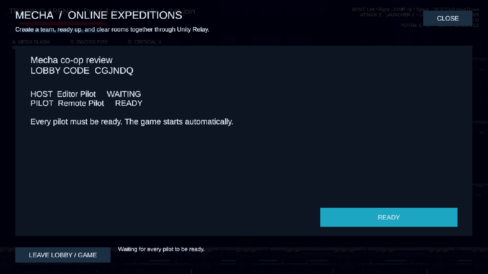
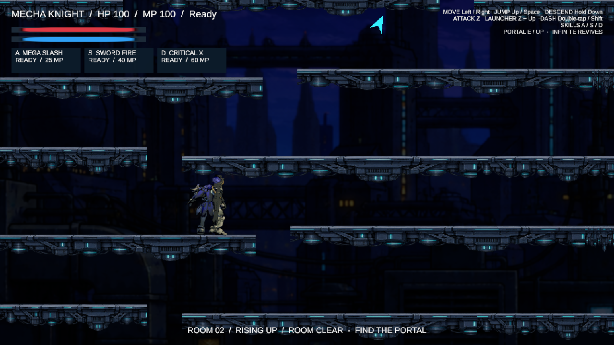
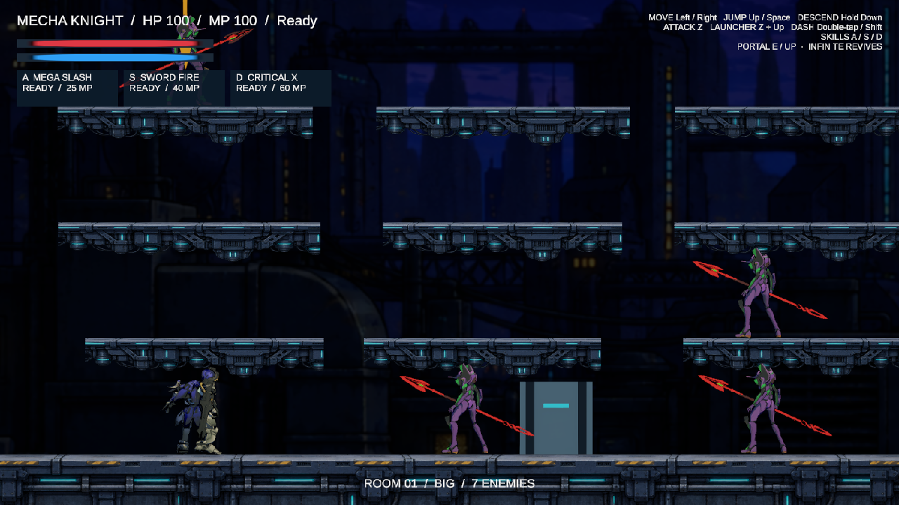

# Rising rooms, enemy roles, and online co-op

Implemented and manually reviewed on 2026-10-15 through the official Unity CLI and Pipeline MCP connection.

## Controls and online flow

- **1** starts a local host, including after leaving an online game.
- **2** joins a local host.
- **3** opens online lobbies. Enter a pilot name, create a named lobby, select a browser result, or join by lobby code.
- The public browser refreshes every **one second** during normal operation and supports name search and paging. Temporary service errors use retry backoff. Waiting-room fallback refresh is slower because Unity also sends live session events.
- Each pilot can toggle **Ready**. Once everyone is ready, the host locks the lobby, verifies readiness again, allocates Relay, and starts FishNet. Both clients enter gameplay automatically.
- **Leave lobby / game** exits the session. A host leaving closes the expedition and returns other players to the browser. Host migration is not implemented.

This uses the installed Unity Multiplayer Services Sessions API for discovery, membership, readiness, and Relay allocation. A custom `INetworkHandler` passes Relay data to the project's existing FishNet Unity Transport. Gameplay continues to use FishNet. The installed SDK supplies the joined Relay allocation in `NetworkConfiguration.RelayServerData`; the separate optional `RelayClientData` field belongs to another netcode integration and is not used here.

`Lobby.asset` owns maximum players, session identity, authentication profile, refresh intervals, connection timeout, and local port. Editor and standalone player authentication profiles are separate so two local processes can join the same cloud lobby as different pilots. The linked cloud project was successfully exercised; no new dashboard configuration or credentials were required.

The uGUI lobby includes create, search, join-by-code, paging, roster, ready/unready, leave, close, busy states, retry messages, and failed-connection recovery. Opening the menu blocks that player's movement/combat intentions while the shared game keeps running. The ordinary HUD advertises the 3 shortcut.

## Rising-room variety and screen borders

Rising rooms choose different arrangements on successive tiers:

- One bridge spanning the entire room width.
- Two broad decks with an uneven horizontal split and a small vertical offset.
- One broad deck and one short side ledge, mirrored between sides.
- Unequal short/long/short decks with a raised middle section.

The room seed determines the arrangement, and all peers reconstruct the same platforms. The physical collider for a wide bridge remains continuous while its existing artwork is tiled. Gaps and offsets remain within the current jump capabilities.

Rising-room framing fits the room width to the actual local camera aspect ratio. Action zoom is held at this fitted width in rising rooms, preventing zoom from revealing empty space past the side boundaries. Vertical follow still uses Cinemachine and the existing damped band. During the live review, room width and camera view width both measured approximately **12.49111 units**. Other room types retain their normal action zoom.

## Enemy roles and presentation

The initial seven-enemy encounter now includes three guards, two hunters, and two lance throwers. Later encounters use the same role pattern.

- **Guards** patrol a small area on their own platform, hold their home position while suspicious, and engage locally. They return home when pulled outside their leash. They do not take interception routes across the room.
- **Hunters** pursue and intercept; a configurable limit controls simultaneous pursuers. Other hunters hold separate home positions.
- **Lance throwers** keep their distance, retreat from nearby players where the platform permits, telegraph their attacks, and launch a visible golden lance on a gravity-driven parabola. Aim includes a small capped movement lead. Enemy decisions, projectile spawning, collision, damage, and expiry run on the server. New rooms remove projectiles from the previous encounter.

The projectile uses a registered FishNet prefab, native Rigidbody movement, swept collision checks, and server-authoritative NetworkTransform replication. It can rise through one-way platforms; descending projectiles can strike them. Lancers use the existing enemy model with a gold crest. Enemy behavior, tactical spacing, and lance tuning are authored in `EnemyTactics.asset`, `EnemyCrowd.asset`, and `EnemyLance.asset`.

Spawn positions have a minimum separation, and crowd avoidance now maintains approximately 1.15 units between nearby enemies instead of deliberately allowing substantial overlap. Far guards stay distributed rather than joining a single pursuit train.

The three existing background layers use darker blue-gray tints in `ParallaxScene.asset`; platform and character lighting are unchanged.

## FishNet synchronization review

The following responsibilities were reviewed across every project NetworkBehaviour. Items marked observed were also inspected between the editor host and a separate Windows player over Unity Relay.

| Feature | Authority and replication | Review result |
| --- | --- | --- |
| Player travel and facing | Existing owner-authoritative NetworkTransform; remote motion sampled for presentation and enemy prediction | Positions observed on both peers |
| Grounded state and locomotion | Server-published grounded SyncVar; remote vertical motion drives Jump/Fall | Both peers observed grounded players correctly |
| Dash | Owner intention, server cooldown/air-dash acceptance, observer effects and protection | Source reviewed |
| Attacks, skills, mana, cooldowns | Owner intention; server validates and applies hits/costs; observer action/VFX messages | Remote player log observed host SwordFire action |
| Player health and revive | Server health SyncVar, reaction/death/reset RPCs; owner and spectators receive teleport reset | Remote HP changed 100 → 88; forced defeat restored HP to 100 at its checkpoint |
| Enemy roles, state, health, movement | Server AI and combat; SyncVars and server-authoritative NetworkTransform | Mixed encounter spawned; defeated count reached zero on both peers |
| Lances | Server-spawned registered prefab, server collision/damage/lifetime, replicated transform | Separate player observed one/two active projectiles and received enemy damage |
| Props | Server health and observer feedback; deterministic per-room placement | Source reviewed |
| Rooms and portals | Buffered room number/seed, server clear/count SyncVars, owner-only travel request with server validation | Both peers moved from room 1 / seed 104729 to room 2 / seed -755716188, with 19 matching platforms |
| Camera, HUD, pointer, lobby panels | Local presentation using replicated gameplay state | Main game and lobby visually inspected |
| Session exit | Cloud session deletion/leave and transport stop | Remote player returned to browser with no players remaining |

Fixes from the review include remote grounded state, inferred remote velocity for animation/prediction, facing from replicated rotation, teleport notification on revive/travel, death presentation for newly observing clients, separate co-op spawn positions, projectile cleanup on room travel, correct Relay data mapping, and reliable local-transport reset after online play.

## Validation receipts and limits

- Unity compilation succeeded. A Windows development player built successfully with zero build errors. Existing optional Cinemachine HDRP assembly-reference warnings remain.
- Used the actual 3 shortcut, create and ready buttons, cloud session membership, and Unity Relay allocation.
- Launched a separate player using the normal join-by-code and ready path. Host and client reported two pilots before gameplay began, then two FishNet player objects after readiness.
- Inspected remote damage, knockback position, grounded state, skill action, projectile presence, room clear, revive, and shared portal travel. The remote player revived without replacing enemies or losing clear progress.
- Inspected the varied rising platforms and measured camera width against room bounds.
- Verified the 1 shortcut starts a fresh local host after leaving Relay, using ordinary Unity Transport with seven fresh enemies.
- The successful two-process run produced no runtime exceptions, missing-prefab errors, or out-of-range prefab IDs. Source whitespace checks passed.

These were manual runtime inspections and source reviews. No automated tests were created or run. Both processes ran on the same Windows computer while connecting through the real Relay service. Four-player load, adverse network conditions, host migration, and other platforms were not exercised.

The validation player accepts optional `--mecha-join-lobby CODE`, `--mecha-ready`, `--mecha-profile NAME`, and `--mecha-network-log` launch parameters. Logging is read-only and available in development/editor builds. It opens no control endpoint. Player-build Pipeline control remains disabled; automatic approval review rejected enabling it because that would add a persistent control endpoint. Validation proceeded using ordinary game connections and log inspection.

The review lobby was deleted, the separate player was closed, and Unity was restored to stopped Play Mode with the original input-focus and background settings. Repeatable native setup is available at **Tools → Mecha → Apply Online Lobby and Enemy Roles**.
