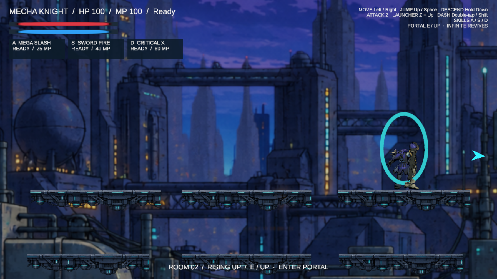
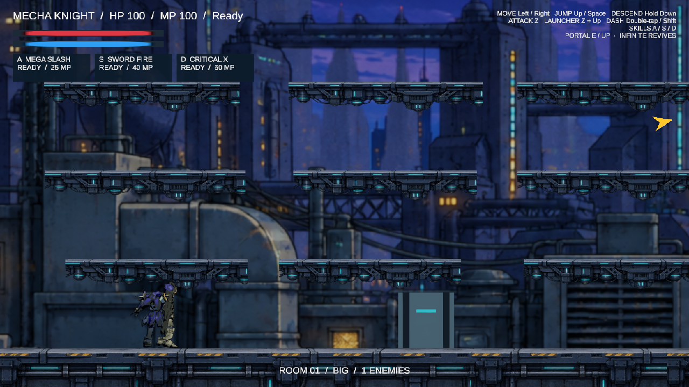
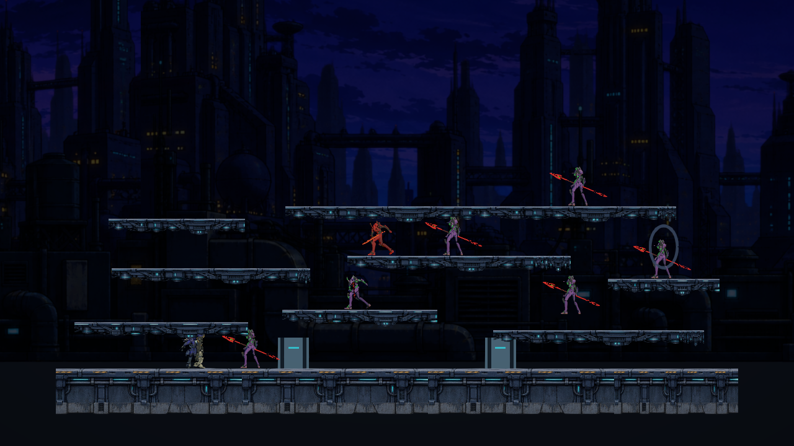

# Procedural rooms and reference camera

Implemented 2026-10-15 using the local Unity CLI and official Pipeline MCP connection. Reference: the user's 29-second recording, `E:/GravacoesOBS/2026-10-15 16-57-11.mp4`, decoded and inspected at half-second intervals.

## Play and controls

Open MainScene, enter Play Mode, and press **1** to host locally. Movement and combat controls are unchanged. Kill every enemy, follow the cyan portal pointer, and press **E** or **Up** near the glowing portal to enter the next room. The portal is visible but locked during combat. Death restores full HP at the current room's start with the existing respawn protection. Defeated enemies remain defeated; the level and clear state survive death.

The yellow edge arrow points to the living enemy nearest to the player whenever no living enemy is visible. Clearing the encounter switches it to the portal. The bottom-center label shows the room number, shape, remaining enemies, and nearby portal prompt.

## Room generation

The first room is 22 units wide, replacing the previous 72-unit arena, with eight staggered decks and seven enemies. Later rooms cycle through these shapes, with different dimensions, platforms, starts, and enemy placements generated from each room's seed:

| Shape | Width | Floating tiers | Travel |
| --- | --- | --- | --- |
| Rising | About one camera width | 7–9 | Up, down, or both |
| Long | 30–38 units | 1–2 | Left, right, or both |
| Big | 23–29 units | 5–7 | Horizontal and vertical |

Later starts are selected from all nine requested positions: four corners and middle, top, bottom, left, and right centers. Spawns snap to safe support surfaces; an odd platform column count supplies a center platform. The portal occupies the support farthest from the start. The current layout uses 1.6-unit tier spacing and small horizontal gaps within the existing player/enemy jump capabilities. Platforms remain one-way and retain Down-to-descend behavior. Floors, platform sprites, parallax backgrounds, crate art, physics, and character assets are reused.

Every encounter is instantiated in one server operation when its room starts. There are no timed waves or replacement enemies. Later rooms contain 7–11 enemies. Using the portal advances the seed, disposes of the old runtime geometry, builds the next room, restores supply crates and player health, updates revival checkpoints, and places a fresh encounter. There is no final-room limit.

`ProceduralLevels.asset` owns room dimensions, spacing, enemy counts, safe-distance tuning, interaction range, pointer colors, and asset references. `ProceduralLevelLayout` produces deterministic data, `ProceduralRoomBuilder` owns Unity geometry, `EnemySpawner` owns encounter spawning/counting, and `ProceduralLevelDirector` owns progression. The director buffers the current room description for joining clients; enemies and travel requests retain FishNet server authority. Runtime code does not modify the configuration assets. Native colliders enforce room boundaries.

The editor setup is repeatable through **Tools → Mecha → Apply Procedural Levels**. It updates the compact room preview, native assets, player prefab interaction component, network component serialization, and existing uGUI HUD.

## Camera and interception

The camera follows the reference's smooth vertical response rather than the former capped airborne offset and landing-only elevation curve. Grounded feet settle near 32% of viewport height, subject to room confinement; the floor remains near 10%. A soft airborne band between 22% and 55% absorbs small movement, then follows continued rises/falls. Vertical smoothing is 0.24 seconds upward and 0.18 downward. A wider safety band keeps feet between 8% and 65% during fast airborne movement, subject to room bounds. Native Cinemachine still owns horizontal composition, lens effects, and confinement.

The one-screen-wide rising room includes a tiny width tolerance. Cinemachine Confiner 2D's native oversize-window handling preserves vertical tracking when rounding or skill/dash zoom makes the lens wider than the room. This fixes the observed fallback that otherwise pinned the camera to the center of a tall room. `RoomCamera.asset` exposes the current vertical tuning; the obsolete landing-curve/airborne-cap controls were removed.

An enemy executing an interception begins its attack when the player enters melee range. The latest combat revision applies the same visible windup to interception and ordinary melee attacks (currently 0.34 seconds); the earlier zero-startup ambush exception was removed at the user's request. Range checks, stun, attack cooldown, and player dash protection remain active.

## Validation and limits

- Unity compilation completed with no compile errors. Source whitespace review passed.
- Confirmed Play Mode frame advancement through the official MCP connection.
- Inspected a live local host with all seven initial enemies already spawned and no replacement spawning after defeat.
- Used actual Input System **E** events to advance through the compact first room, Rising Up, Long Left with a TopRight start, and Big with a BottomRight start. These were direct manual runtime inspections, not automated tests.
- Visually checked the edge arrow and unlocked portal; fixed a missing CanvasRenderer and corrected existing sprite top pivots against collider tops.
- Inspected the top of the rising room after the confiner fix: feet at viewport Y 0.32, player world Y 10.90, camera Y 12.15. Inspected a multi-tier drop: player Y 4.13 with downward velocity 7.6 and feet retained at viewport Y 0.08.
- Applied lethal damage during a cleared rising room: HP returned from 0 to 100 at its own start, with room number 2, zero enemies, and portal-unlocked state preserved.
- Final live session had zero runtime console errors. Existing optional Cinemachine HDRP assembly-reference warnings can appear during compilation.

No automated tests were created or run. A second client/late-join session was not exercised; networking was reviewed in source and exercised as a local host. Camera feel is a visual interpretation of the recording, available for tuning in the profile. This initial generator uses connected tiers and corridors rather than handcrafted room motifs. Unity was returned to stopped Play Mode and temporary input/background overrides were restored.

## Encounter polish

The opening room now uses eight authored decks instead of fifteen regular grid platforms: a lower crossing, uneven side shelves, a central causeway, and a broad upper bridge. Widths range from 3.6 to 12.6 units; neighboring tops use offsets instead of matching rows. Subsequent Long/Big rooms also merge unequal runs and stagger their heights. Rising motifs remain intact.

Enemy rise/fall gravity is now 40/64, with maximum launch speed 15 and terminal fall speed 28. This preserves the maximum jump height while shortening airtime. Nearby overlapping ledges use only the launch speed needed to clear their height plus 0.4 units; gap crossings retain the full arc. A live 1.6-unit step produced launch speed 12.65, then landed successfully. All eight opening surfaces were reachable through the live enemy navigation graph.

Ranged enemies release the same imported 3D lance they hold. The projectile starts at the hand, rotates along its ballistic path, and uses the original weapon materials and size. The hand remains empty after release until the next attack windup begins; FishNet replicates that availability for observers and late joiners. The previous line-rendered projectile and floating crest were removed. Combat and hand presentation remain separate components. See [the latest combat and platform fixes](CombatAndComboConfigurator.md).

Validation: compilation passed; two local-host Play Mode inspections confirmed seven enemies, the revised geometry, registered lance NetworkBehaviour, two live 3D projectiles without LineRenderers, empty hands after firing, and rearming. No new runtime errors appeared. These changes were inspected on a local host; a separate client was not rerun for this polish pass. No automated tests were created or run. The editor was restored to stopped Play Mode with its previous focus/background behavior.

