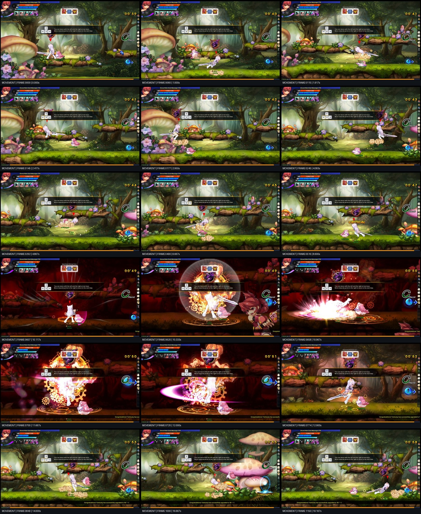
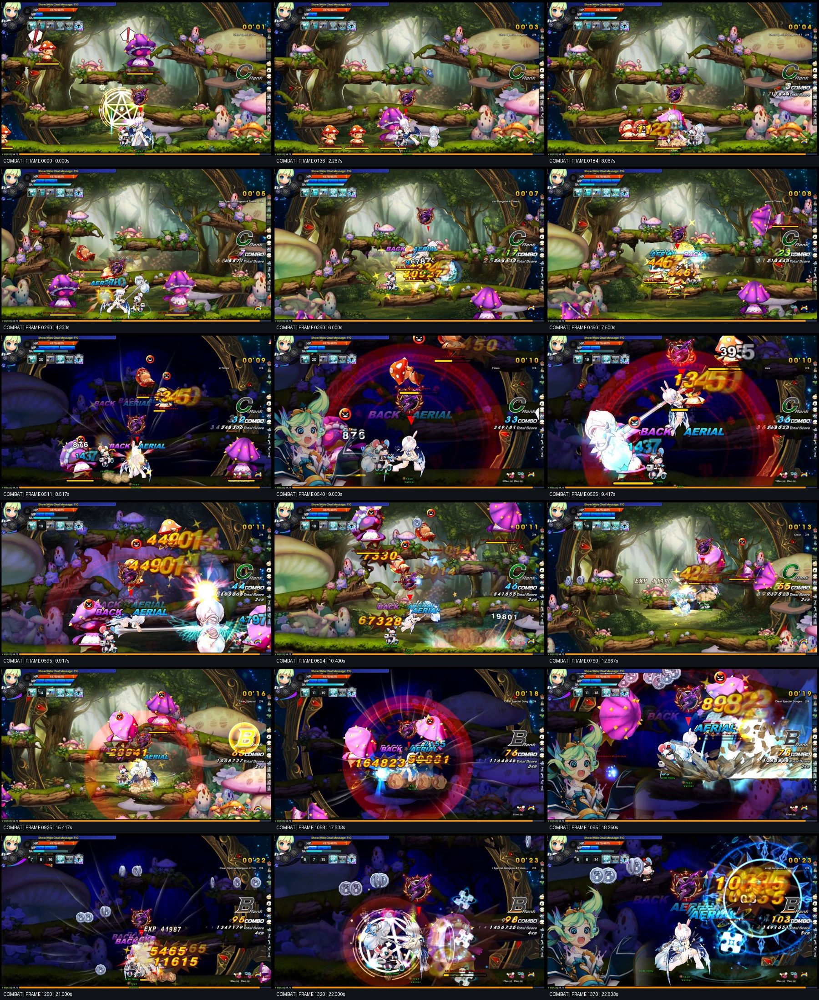
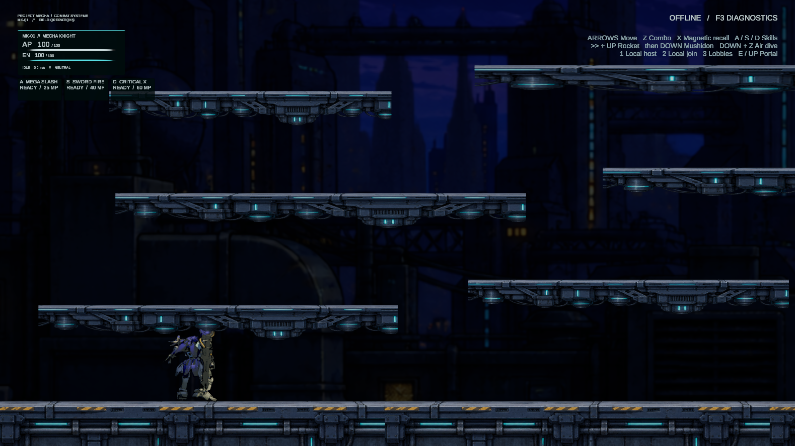
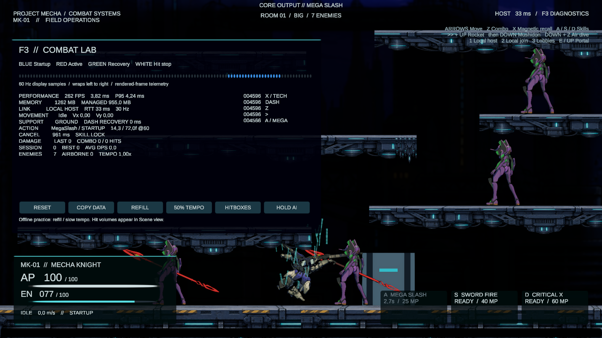

# Reference movement and combat cadence — 2026-10-16

This pass implements the user's movement/combat request in the existing mecha prototype. The supplied clips are visual evidence, not instructions to execute. No text embedded in the recordings was treated as an instruction.

## Evidence and precision

Both original MOV files were decoded sequentially, without skipping frames. All 2,777 captured frames were inspected in ordered, frame-numbered contact sheets, with larger frames used for details. The study files remain in ignored `Temp/ReferenceFrames/`. The repeatable extraction tool is `AgentScripts/AnalyzeReferenceClips.py`.

| Recording | Captured frames | Rate | Duration | SHA-256 |
|---|---:|---:|---:|---|
| `2026-10-16 15-54-34.mov` | 1,301 (0–1300) | 60 fps | 21.6833 s | `B6EEC94309610CB91E308343DF15FA9B264CBF9C07F026EE401E91D22C58525E` |
| `2026-10-16 15-56-48.mov` | 1,476 (0–1475) | 60 fps | 24.6000 s | `72C2414E7DD7B87AF6E23988E59954492607CC53BE4738E388772A6B9943A1FD` |

Frame numbers below are zero-based; time is frame / 60. Capture frames are not necessarily distinct source-game simulation frames: repeated poses and held frames are visible. Camera scrolling, compression, the tutorial overlay, overlapping effects and incomplete input visibility prevent recovery of exact original velocities, hitboxes, invulnerability, input buffers or source animation timing. A visible held pose is not proof that every command is rejected. The command grammar comes from the user's explicit description; implementation numbers below are calibrated design choices, not falsely claimed reverse-engineered constants.

The first recording contains both traversal and a skill demonstration. The second contains both combat and movement. Both informed this pass.

## First recording: movement study

| Frames / time | Observation across the sequence | Implementation consequence |
|---|---|---|
| 0–42 / 0–0.70 s | Largely stationary on the ledge; no continuous background traversal. | Neutral positioning must be stable. |
| 43–95 / 0.72–1.58 s | Departure to the lower lane followed by comparatively restrained horizontal travel. | Holding a direction is deliberately slow. A dash must not silently become permanent maximum speed. |
| 96–113 / 1.60–1.88 s | Upright/turning poses separate the travel phases. | Preserve short transitions and commitment; do not make all actions instantly reversible. |
| 114–170 / 1.90–2.83 s | Ground streaks, short forward bursts, a small rise and return to the floor. | Launch velocity followed by decay, with a separate jump/dash route. |
| 171–236 / 2.85–3.93 s | Another diagonal movement phase followed by sustained lower-lane travel. Dust persists behind the moving actor. | Distinguish the launch, airborne momentum and ordinary run; reuse native smoke/streak effects. |
| 237–299 / 3.95–4.98 s | Repeated changes in height and forward travel, with compressed downward returns and short slides. | Rocket followed by Down converts vertical launch into a longer horizontal slide. |
| 300–421 / 5.00–7.02 s | Air movement/attack poses interrupt travel; actions occupy visible time. | Air attacks commit; arbitrary steering/down input cannot erase them. |
| 422–467 / 7.03–7.78 s | Low/held poses followed by a return to upright movement. | Do not erase every pause when tuning for responsiveness. |
| 468–606 / 7.80–10.10 s | A localized series of sword poses, short strokes and a visible critical cue around frame 516. | Combo branches remain distinct attacks, with startup and recovery. |
| 607–642 / 10.12–10.70 s | Abrupt dark/red backdrop; luminous charge detail; a long held emphasis pose. | Skill startup locks movement and attacks while the environment darkens. |
| 643–676 / 10.72–11.27 s | Large floor-oriented white/pink burst, then settling. | Separate charge, impact and recovery; keep the large effect at impact. |
| 677–715 / 11.28–11.92 s | A second luminous held charge/pose. | The anticipation is a substantial part of the skill's weight. |
| 716–738 / 11.93–12.30 s | Broad horizontal arc/ring and bright core. | Retain the existing native flame/ember skill effects; avoid filling every startup frame with the final impact. |
| 739–774 / 12.32–12.90 s | Recovery and return of the normal environment. | Fade the focus treatment out instead of snapping all presentation off at impact. |
| 775–942 / 12.92–15.70 s | Repeated short launches, descending returns and long low slides; dust follows the trajectory. | Fast travel comes from repeated commands, not held input. |
| 943–1079 / 15.72–17.98 s | Rightward scrolling followed by reversal/return. Camera motion makes absolute speed harder to measure. | Tune ratios and cadence; do not mistake screen displacement for world displacement. |
| 1080–1255 / 18.00–20.92 s | Another sequence of floor bursts and rises approaching the exit. | Preserve repeatable chains with finite recovery and explicit braking. |
| 1256–1300 / 20.93–21.67 s | Exit glyph/transition and fade. | Reference context only; no unrelated room-flow change. |

The essential motion envelope is a steep acceleration at the command, followed by a visible loss of velocity. Landing should retain a slide where that command promises one. Neutral and the opposite direction provide precision, but the first few launch frames remain committed. Constant high speed would destroy the distinction between walk, run and command mastery.

## Second recording: combat study

| Frames / time | Observation across the sequence | Implementation consequence |
|---|---|---|
| 0–130 / 0–2.17 s | Initial entry/approach and enemy movement; little sustained attack output. | Keep setup/neutral separate from attack startup. |
| 131–177 / 2.18–2.95 s | First short strikes: actor poses commit, small flashes appear, targets react and shift. | Movement input does not drive a grounded combo; each hit supplies an authored step and an opposing target impulse. |
| 178–250 / 2.97–4.17 s | Repeated hits, bright contact flashes, damage numbers and brief reaction poses. | Every confirmed hit triggers flinch, directional sparks/core/smoke/debris and readable damage feedback. |
| 251–374 / 4.18–6.23 s | Faster follow-ups and movement through the group; targets are displaced while the attacker follows. | Match attack step distance with target push. A deliberate critical branch can cross through a target. |
| 375–510 / 6.25–8.50 s | Airborne targets receive further strikes; arcs/streaks and fresh numbers mark discrete pulses. | Airborne hits re-lift instead of merely adding horizontal damage. Hit stop is short and per actor. |
| 511–547 / 8.52–9.12 s | Environment darkens sharply, a red/blue ring develops and poses are held. | A skill has an unmistakable locked charge phase; nearby enemies slow locally. |
| 548–562 / 9.13–9.37 s | Strong upward motion precedes the next contact. | Launch and juggle behavior must create follow-up opportunities. |
| 563–623 / 9.38–10.38 s | Very bright contact, large circular sweep, then a broad floor burst. | Multi-hit skills have separate pulses, with a larger final accent. |
| 624–749 / 10.40–12.48 s | Return to a normal-brightness environment and continued attacks, including airborne feedback. | Resume ordinary cadence after the skill; do not leave a global slow-motion state behind. |
| 750–1009 / 12.50–16.82 s | Vertical pursuit and repeated juggle contacts; numbers and hit flashes overlap but attacks remain discrete. | A hit renews airborne lift and stun; landing cancels an air attack immediately. |
| 1010–1057 / 16.83–17.62 s | Concentrated spinning/radial activity; debris/ground fragments become prominent. | Retain separate anticipation/contact/recovery and native effect layers. |
| 1058–1090 / 17.63–18.17 s | Another abrupt dark focus phase, circular emphasis and large ground-oriented effect. | Reapply focus from the current skill state, without accumulating camera zoom offsets. |
| 1091–1138 / 18.18–18.97 s | Large damage cue and displaced airborne enemies as the main sweep fades. | Damage, flinch, lift and presentation should describe the same accepted pulse. |
| 1139–1258 / 18.98–20.97 s | Repositioning and more ordinary contacts between special effects. | Movement and ordinary attacks regain control after recovery. |
| 1259–1304 / 20.98–21.73 s | Renewed darkening and held charge poses. | Skills remain committed; another attack/dash/tech command cannot cancel them. |
| 1305–1338 / 21.75–22.30 s | White geometric/radial glyph effect and contact flashes. | Use the project's existing skill effects and native particles; original source artwork is not available. |
| 1339–1412 / 22.32–23.53 s | Blue electrical ring, repeated pulses, fresh numbers and re-lifts. | Multi-hit effects and gameplay pulses share their authored timeline. |
| 1413–1475 / 23.55–24.58 s | Another cast/impact overlaps the fading ring before the clip ends. | The recording does not expose the full final recovery. Do not invent a measured endpoint. |

## Applied tuning and controls

All speeds are project world units/s. All durations are seconds; the frame equivalents below use 60 Hz for authoring/readability. Unity physics still uses the project's existing fixed timestep, so these are not a promise of a 60 Hz deterministic fighter simulation.

| Movement | Command | Tuning |
|---|---|---|
| Walk | Hold Left/Right | 1.8 |
| Dash → relaxed run | Double-tap direction (Shift is an accessibility shortcut) | 10.5 launch, decays to 52% over 0.20 s; held direction settles to 4.2 run |
| Rocket | Dash + Up within 0.0833 s, either order | 14 horizontal, 7.8 vertical; 0.25 s impulse |
| Mushidon | Down within 0.25 s of Rocket | 18.5 horizontal, 12 downward; 0.3667 s impulse, carries across landing |
| Brake | Opposite direction | Available after the first 0.0667 s of an impulse |
| Recovery | After an impulse | 0.0667 s; short command buffer is 0.0833 s |

Jump → double-tap → Down remains available as a separate route when the dash occurs outside the Rocket chord window. Input is event-based; held directions do not automatically repeat advanced commands. A ground dash can transition into the available air dash. Ground contact replenishes the air dash.

| Attack | Duration | First impact | Branch opens |
|---|---:|---:|---:|
| Slash 1 | 25f | 7f | 14f |
| Slash 2 | 28f | 9f | 16f |
| Slash 3 | 34f | 12f | 23f |
| Air slash | 28f | 8f | 18f, or immediate landing cancellation |
| Rising slash | 30f | 8f | 19f |
| Critical cross-through | 0.45 s | 0.09 s | 0.31 s |
| Magnetic recall | 0.55 s | 0.18 s | 0.37 s |
| Mega Slash / Sword Fire | 1.20 s | 0.65 s | Fully locked until completion |
| Critical X | 1.30 s | 0.65 s | Fully locked until completion |

- **Z:** authored ground/air combo; buffer the next attack during commitment.
- **Up during a ground combo:** launcher branch at its cancel window; jump again in the launcher's recovery to follow.
- **Double-tap during a ground combo:** critical cross-through branch in the chosen direction. It is an attack, not a universal escape.
- **A/S/D:** skill cancels from an eligible ordinary attack window; skills themselves reject attack, skill, dash and tech cancellation.
- **Down+Z in the air:** committed dive; one hit per target, immediate cancellation on landing. A queued dive retains the Down+Z intent after Down is released.
- **X / gamepad right-stick click:** magnetic recall, usable as an ordinary combo branch. Pull direction is toward the attacker, rather than always along the attacker's facing.
- Ordinary steering/down does not erase an attack. Air attacks remain locked until their branch window/completion or landing. Skills suspend their user's motion, including in the air.

A normal strike drives the player forward briefly at impact, while the enemy receives its own impulse. Ordinary airborne hits use 6.3 lift; the launcher uses 11.5. Stunned airborne enemies use 55% of their normal traversal gravity. This provides a follow-up opportunity without changing ordinary enemy platform jumps. The critical branch uses its explicit pass-through interval, with no dash invulnerability granted by that branch. Existing real dash protection remains separate.

## HUD and F3 lab

The existing uGUI/TMP hierarchy was modified in place. The cockpit treatment uses dark translucent panels, thin cyan rules, prominent AP/EN numbers, a quiet mission line and equipment-style skill modules. Inspiration is Armored Core VI's instrumentation and fighter training feedback; no game UI artwork was imported. See the [official Armored Core VI gameplay context](https://blog.playstation.com/2023/04/27/armored-core-vi-fires-of-rubicon-launches-august-25-new-gameplay-details/).

**F3 toggles Combat Lab.** It displays average FPS/frame ms, P95 frame ms, allocated/managed memory, actual FishNet RTT/tick rate, movement state/velocity/support/recovery, action/phase/elapsed frames/cancel time, last/combo/session/best damage, session-average DPS, enemy/airborne counts and timestamped input history. The colored strip is sampled presentation telemetry, not authoritative SF6-style frame advantage or proof of collision-active frames. Pausing the Editor resets the performance sample window so paused time is not reported as a game stall.

Buttons: reset counters, copy the current telemetry/input snapshot, refill offline practice resources, toggle offline 50% tempo, show the attack volume in Scene-view Gizmos, and hold/resume enemy AI. AI hold is host/offline-authority only; flinch, damage, knockback and physics continue. Refill/slow mode deliberately refuse a spawned network actor. Practice tempo restores when disabled or when entering a network session.

Skill focus is a separate presentation observer: a native SpriteRenderer darkens the scenery behind actors, native UI Images supply the letterbox/brief impact flash, Cinemachine changes the lens by −7.5%, and authored native particle profiles provide charge and inward magnetic streaks. The existing VFX Graph skill fire/embers remain in use. No runtime mesh/pixel shape generator was introduced.

## Validation and limits

Compilation and live source review were used; no automated tests were created, modified or run. Manual inspection used the official Unity MCP/Pipeline tools and operator-driven input gestures, with temporary enemy isolation in Play Mode. Only an Editor local host was used for the changed RPC acceptance/state paths. No extra player build, Relay allocation or multi-client session was run.

Observed locally:

- Walk settles at **1.800**. A regular dash decays rather than holding launch velocity. Rocket sampled **12.370 horizontal / 5.880 vertical** shortly after launch. Mushidon sampled **16.334 horizontal** on the ground and carried several times the basic step distance.
- The owner dash now uses its own end time; a later host/server acknowledgment cannot extend its visible motion duration.
- Ground hit → launcher → air hit dealt **18 + 26 + 20 = 64**, shown as **3 hits**, reducing an isolated enemy from 90 to 26 HP. The target stayed airborne and re-lifted; a later inspection still showed positive vertical velocity and remaining stun.
- The critical branch crossed a living target: player x −7.244, target x −7.718. Its motion was subsequently tightened to end at the explicit cross-through interval, removing an excessive deceleration tail.
- Magnetic recall pulled a target toward the attacker: target x −7.151, positive velocity **5.880**, attacker x −4.454 facing left.
- A dive reached **−18 vertical velocity**, then became **Ready** on ground contact before its scheduled first hit. No delayed air hit was forced after contact.
- While a skill was active, Right + Shift + Z + X left the player stationary and the skill active. Nearby enemy tempo was **0.18**, distant enemies **1.0**; the backdrop reached **0.92 alpha**, and camera offset reached approximately **−0.07498**.
- Native HUD rendering, F3 input history, six button bindings, per-phase colors, damage totals, and the skill focus treatment were inspected in captured Play Mode images.

Corrections found during inspection: preserve buffered dive intent, clamp damage readouts to actual remaining target health (including crates), preserve hit-stop time in action/motion/animation clocks, stop host acknowledgments extending owner impulses, lengthen juggle opportunity, and keep critical movement bounded.

Final compilation/editor restoration and inventory results are recorded below after the last verification. Exact original animation poses, fantasy effects, source hitboxes and hidden cancel windows were not reproduced bit for bit: this is a reference-calibrated mecha implementation using the available animation/effect assets. User feel review is still needed to judge equivalence.

## Final verification

The final targeted input pass confirmed relaxed run at **4.200**, Rocket at **12.672 horizontal / 6.360 vertical**, and grounded Mushidon at **16.383**. Opposite input ended the accepted impulse and decelerated through recovery. Braking also notifies the server/observers so its protection and effects do not continue for the original full impulse duration.

After tightening the critical interval, it moved approximately **2.11 units** (x −8.691 to −6.582 in the inspected samples) and stopped at zero horizontal velocity during recovery. The native X input action then queued magnetic recall from that recovery; the isolated target's accumulated damage was **64** (18 + 36 + 10), matching its remaining 26 HP. X uses the existing native Player input map and supports keyboard/gamepad bindings.

Final Unity compilation completed with `failed: false`, no compiler errors and `compilationFailed: false`. Source whitespace review passed. Existing FishNet obsolete-API warnings remain unrelated. MainScene was saved, clean, with **zero missing scene scripts**; all six diagnostic buttons have exactly one persistent callback. The 104 frame cells are native Images. Play Mode was stopped and `Application.runInBackground` restored to its original **false** value. Temporary lane/target isolation and AI hold changes were discarded with Play Mode. Generated captures were moved out of Assets through AssetDatabase; review images are below.

### HUD placement and locomotion playback follow-up

Armor/energy now anchor at the top left, below the project identifier, with the skill cards immediately underneath. Anchors and offsets are authored in GameplayHudLayoutSettings and applied through Unity APIs. The cockpit image above shows the updated layout in offline practice.

The subsequent size request halves the native group scale: the pilot panel occupies 174 × 74 reference pixels and the skill row 222 × 37, each using 75% less area than before. The project identifier follows the same scale; closer offsets keep the group compact. Skill labels use a relatively larger font so names and readiness/cost still fit in two lines. Offline Play Mode capture and live TMP inspection confirmed all three labels had two lines and no overflow. Compilation passed, the current runtime console had no errors/warnings, and MainScene was restored clean in stopped Edit Mode. No automated tests or network sessions were used for this layout adjustment.

Locomotion playback follows actual horizontal speed rather than always playing at 1x. PlayerAnimation uses 4.2 units/s for the Run clip and 10.5 units/s for Dash; EnemyAnimation uses 3.6 units/s. Profiles also own a 0.2–2.5x range and 0.05 s native Animator parameter smoothing. Idle/jump/fall retain their normal playback, while attack/reaction clips retain their authored duration synchronization and hit stop.

Manual offline Play Mode inspection measured walk at 1.8 units/s and 0.42857x playback, run at 4.2 units/s and approximately 1x, a decaying dash at 8.10 units/s and 0.866x, and a Mushidon slide at 14.63 units/s and 1.498x. The last two retain the short smoothing response as the impulse decays. Slash1 remained active at its duration-derived 1.28x, and stopping returned to Idle at 1x. Native Animator state speed multipliers were inspected alongside the parameter. Compilation completed without errors, and the runtime console reported zero current errors/warnings. No automated tests or network sessions were run. MainScene was restored clean with Play Mode stopped and the original background setting restored.

The final maintained-file inventory contains **2,924 files** (22 AI Generated, 499 Placeholder, 2,403 Others). Native labels cover **1,273 importable assets**; 12 assets received new labels in this pass. New gameplay content remains provisional.
