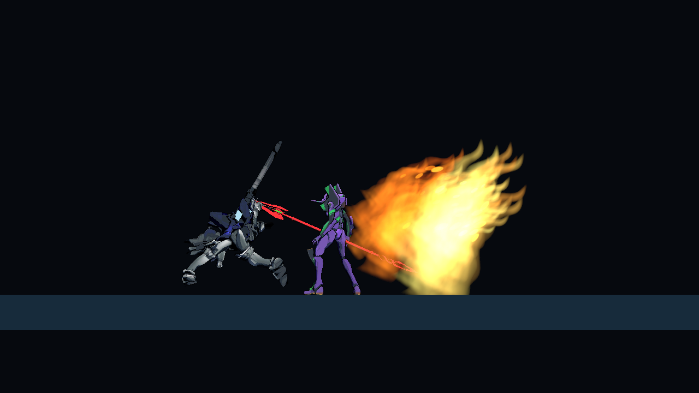

# Sword Fire VFX

The supplied `unity-vfx-graph` skill was installed in `.agents/skills/unity-vfx-graph/`, preserving its SKILL.md and README.md. Its original source under `Assets/_Project/NewSkills` was kept. The official Visual Effect Graph package **17.3.0** matches the existing URP **17.3.0**.

**S / Sword Fire** now emits a GPU-simulated flame wave with orange/red fading tongues, a bright yellow core, upward turbulence and trailing embers. Each of its three existing hit pulses emits one visual burst at that pulse's authored reach. Left-facing casts mirror the local simulation while retaining upward motion. Damage, attack timing, mana and cooldown are unchanged.

## Editing

- `Assets/_Project/Settings/Effects/SwordFireVfx.asset`: flame/ember counts, HDR color gradients, overall scale, lifetime, and viewing-distance budget.
- `Assets/_Project/VFX/Graphs/SwordFire.vfx`: flame initialization, movement/turbulence, size and color over life, and additive output.
- `Assets/_Project/VFX/Graphs/SwordFireEmbers.vfx`: sparks/embers with gravity and drag.
- `Assets/_Project/VFX/Textures/SwordFireFlame.asset`: procedurally authored transparent flame shape.
- `Assets/_Project/VFX/Prefabs/SwordFireBurst.prefab`: both native VisualEffect components. The prefab is inactive so the emitter can apply property overrides before activating its OnPlay event.

Both graphs expose their burst count and gradient on the blackboard. Each simulation is capped at 256 particles, each configured count is capped at 128, and defaults emit 48 flames + 20 embers per pulse. Spawners run once, and temporary instances are destroyed after 1.2 seconds. Distant cosmetics are skipped beyond the configured camera distance. VFX Graph requires compute-shader support.

`PlayerCombatVfx` calls the separate emitter only for SwordFire. Owners and FishNet observers already run the same attack-pulse presentation path, so the visual follows replicated actions without adding another gameplay RPC or networked damage object. The same branch works for Sword Fire pieces assembled in ComboConfigurator.

Reapply native asset setup using **Tools > Mecha > Apply Sword Fire VFX Graph**. The editor adapter targets the installed VFX Graph 17.3 authoring model; runtime uses Unity's public VisualEffect API. Graphs, textures, prefab and settings were created through Unity APIs.

## Validation

- Compilation and native graph/shader import completed successfully.
- Live RTX 4060 Play Mode inspection confirmed GPU particles rendered, correct pulse locations, mirrored left/right casts, orange/red aging and embers.
- A paused second-pulse frame contained two flame systems at 48 live particles each and two ember systems at 20 each. Both systems were visible and not culled.
- Resuming the attack returned to Ready and left zero VisualEffect instances after cleanup.
- No runtime console errors appeared in the completed visual inspection. The final Windows development build includes both gameplay and ComboConfigurator.
- No automated tests were created or run. MainScene and stopped Play Mode were restored, along with the original background setting.

The replication hookup was reviewed against the existing observer action path; a second graphical client was not rerun for this cosmetic pass.
